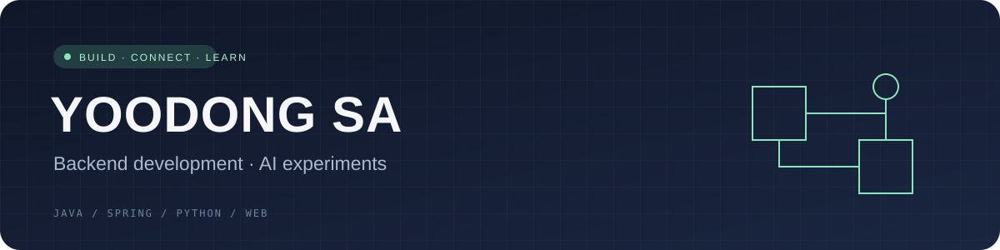

  

# 안녕하세요, 사유동입니다 👋

Java와 Spring으로 서비스를 만들고, AI를 개발 과정에 연결하는 방법을 실험합니다.

복잡한 요구사항을 코드로 풀어내고, 직접 써볼 수 있는 작은 제품으로 만드는 데 관심이 있습니다.

### Build · Connect · Learn

- Backend: Java · Spring · MyBatis · SQL
- Web: JavaScript · React
- Exploring: Python · 문서 처리 · AI-assisted development

### Selected projects

[antiplan](https://github.com/yoodongsa/antiplan)  
취향을 입력하는 단계형 화면을 갖춘 위스키 추천 웹 프로젝트. Next.js · React · TypeScript.

[chatbot](https://github.com/yoodongsa/chatbot)  
레벤슈타인 거리로 질문을 비교해 응답을 찾는 Python 학습 프로젝트. 생성형 모델이 아닌 문자열 유사도 기반 구현입니다.

### Next experiments

반복되는 일을 줄이는 도구와, 아이디어에서 구현까지 이어지는 AI 활용 방식을 실험하고 있습니다.
